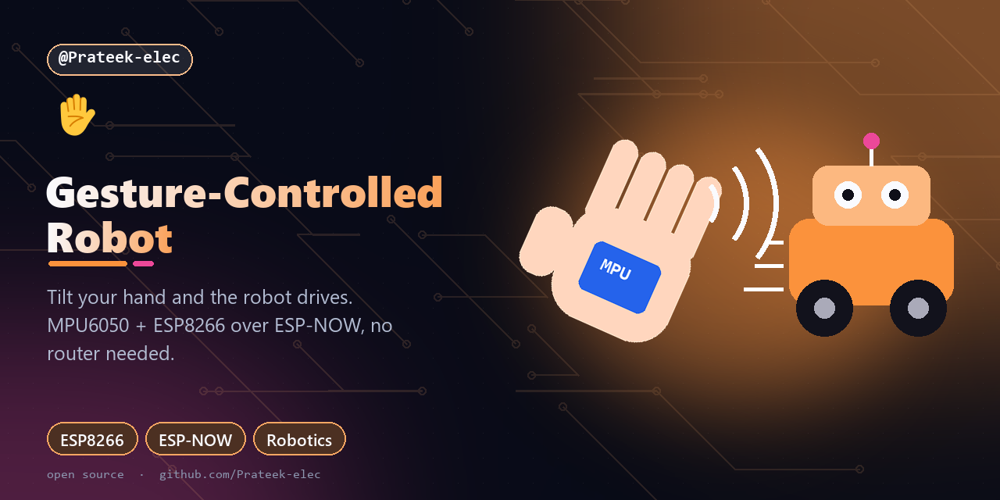

<div align="center">



**Tilt your hand, and the robot drives. An MPU6050 on your hand reads the tilt, an ESP8266 sends it over ESP-NOW (no Wi-Fi router, no app), and a second ESP8266 drives the motors through an MDD10A driver.**


### ▶️ [Watch the demo video](media/demo.mp4)

</div>

---

## 🔥 Why it hits different

- ✋ **Drive with your hand:** tilt forward, back, left or right and the robot follows.
- 📶 **ESP-NOW, no router:** peer-to-peer and low latency, works anywhere.
- ⚡ **Fast loop:** the hand unit reads the MPU6050 every 10 ms.
- 🎬 **Demo video included:** see it run before you build it.

## How it works

```text
 HAND UNIT                                   ROBOT UNIT
┌───────────────────┐   ESP-NOW (2.4 GHz)  ┌────────────────────┐
│ MPU6050 ──I²C──►  │  ──────────────────► │ ESP8266            │
│ ESP8266           │  {front, back,       │   │ PWM + DIR        │
│ tilt > 30° ⇒ cmd  │   left, right}       │   ▼                │
└───────────────────┘                      │ MDD10A ──► 2× DC   │
                                           └────────────────────┘
```

1. The **transmitter** reads pitch and roll from the MPU6050 every 10 ms.
2. Tilting past **±30°** sets *forward*, *back*, *left* or *right*.
3. The command is sent peer-to-peer over **ESP-NOW**: low latency, no router, works anywhere.
4. The **receiver** drives two DC motors through the **MDD10A** dual motor driver. A level hand means stop.

## Hardware

| Hand unit (transmitter) | Robot unit (receiver) |
|---|---|
| ESP8266 (NodeMCU / Wemos D1 mini) | ESP8266 (NodeMCU) |
| MPU6050 (GY-521) | Cytron MDD10A dual motor driver |
| Battery / power bank | 2× DC gear motors + chassis |
| | Motor battery |

**Wiring:** see [WIRING.md](WIRING.md).
Quick reference: MPU6050 SDA → D2 (GPIO4), SCL → D1 (GPIO5). MDD10A PWM1/DIR1 → D1/D2, PWM2/DIR2 → D6/D5.

## Get it running

1. Install the **ESP8266 board package** in the Arduino IDE and the **MPU6050_light** library (Library Manager).
2. Flash [`receiver/receiver.ino`](receiver/receiver.ino) to the robot's ESP8266. Note its MAC address. You can print it with `WiFi.macAddress()`.
3. In [`transmitter/transmitter.ino`](transmitter/transmitter.ino), set `broadcastAddress[]` to the receiver's MAC.
4. Flash the transmitter. Keep the hand unit **still and flat** for about 1 s at power-up while it calibrates.
5. Tilt to drive. 🎮

## Ideas to extend it

- Proportional speed (more tilt = faster) instead of fixed ¼ speed
- Failsafe: stop the robot if no packet arrives for 200 ms
- Swap the hand unit for a glove with a flex sensor to trigger a gripper

## License

[MIT](LICENSE) © Prateek Sarkar

---

<div align="center">

### If this made you go *"wait, that's sick"* 👀

**Drop a ⭐ so more builders find it, and share it with someone who'd build one.**

[](https://twitter.com/intent/tweet?text=Tilt%20your%20hand%20and%20the%20robot%20drives%20%E2%9C%8B%F0%9F%A4%96&url=https%3A%2F%2Fgithub.com%2FPrateek-elec%2Fhand-gesture-controlled-robot-espnow)
[](https://www.linkedin.com/sharing/share-offsite/?url=https%3A%2F%2Fgithub.com%2FPrateek-elec%2Fhand-gesture-controlled-robot-espnow)
[](https://github.com/Prateek-elec)

</div>
